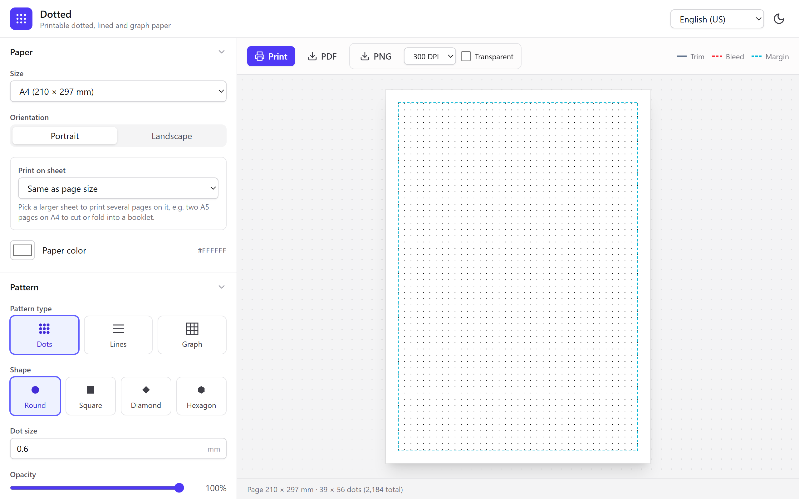
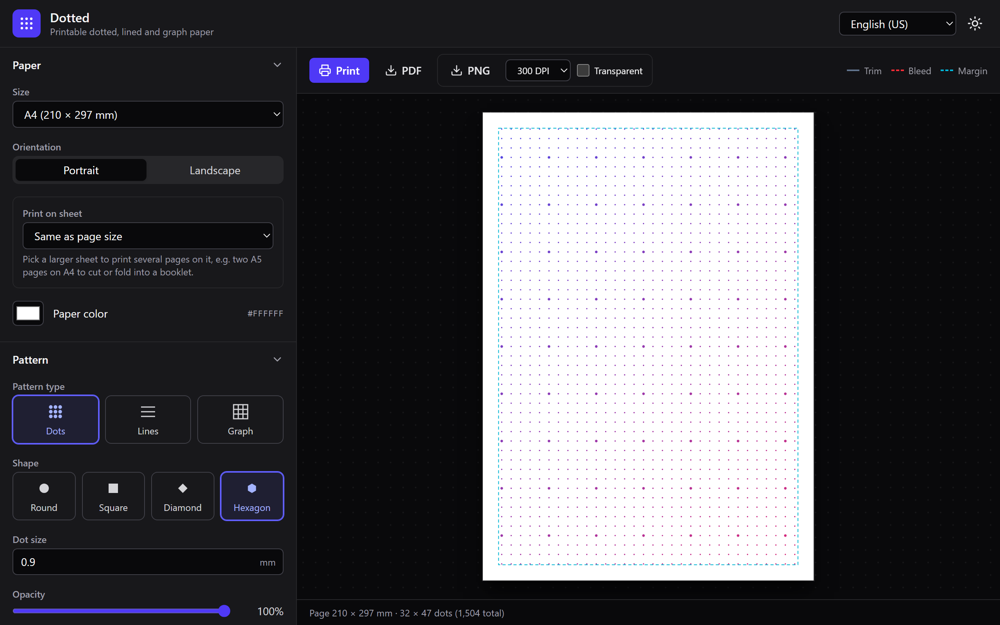
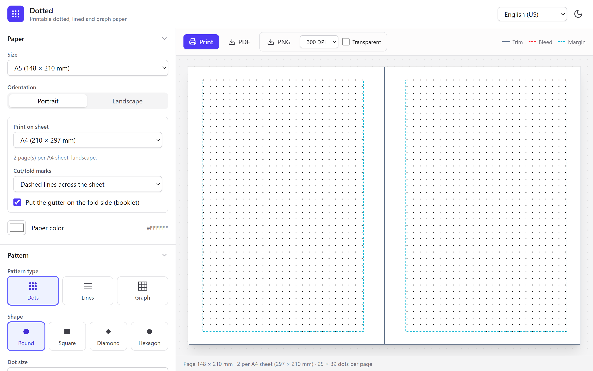
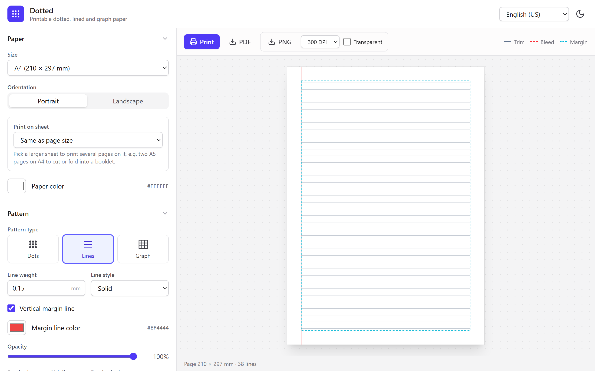
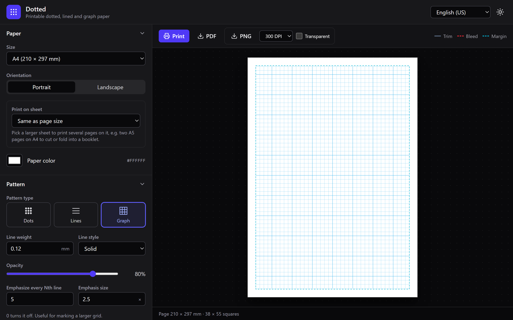
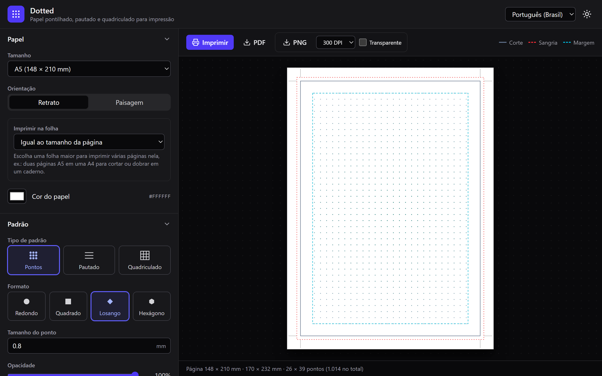

# Dotted

Make your own printable dotted, lined or graph paper. Pick a paper size, pattern, spacing and colors, then print it or export it to PDF or PNG. Everything runs in your browser: no sign-up, no server, no tracking.

**Try it:** [dotted.rfcstudios.com.br](https://dotted.rfcstudios.com.br)



> [!NOTE]
> **This project was vibe coded.** It was built almost entirely by an AI coding assistant ([Claude Code](https://claude.com/claude-code)) from a list of user stories, with a human steering, testing and deciding what to ship. It works and has been checked by hand, but it hasn't been through a traditional code review, so expect the odd rough edge. Bug reports and pull requests are very welcome.

## Why?

Dot-grid, lined and graph notebooks are great for bullet journals, sketching, lettering, notes and planning, but store-bought ones never have quite the right spacing, line weight or margins. This app lets you make exactly the page you want and print as many as you like, including small booklets folded from regular A4 or Letter paper.

## Features

- 📄 **Many paper sizes:** A3–A6, B4–B6, US Letter, Legal, Tabloid, Half Letter, Executive, Traveler's Notebook, or any custom size. Portrait or landscape.
- 🔲 **Three patterns:** dots, ruled lines (with an optional notebook-style margin line) and graph paper.
- ⚫ **Four dot shapes:** round, square, diamond and hexagon, with adjustable size and opacity.
- ✏️ **Line options:** line weight and solid, dashed or dotted lines for lined and graph paper.
- 📏 **Flexible spacing:** the same spacing on both axes by default, or separate horizontal and vertical spacing.
- ✨ **Emphasis:** make every Nth dot bigger, or every Nth line thicker, to mark out a larger grid.
- 🖨️ **Print-shop helpers:** margins, a binding gutter, bleed, crop marks, and on-screen guides for the trim, bleed and margins.
- 📚 **Booklets:** print several pages on one sheet (for example two A5 pages on landscape A4) with cut/fold marks and the gutter on the fold side.
- 🎨 **Colors:** black by default, any solid color, or a linear or radial gradient. The paper color is adjustable too.
- 💾 **Presets:** save your favorite setups in the browser and export or import them as a JSON file.
- 🌗 **Light and dark mode.**
- 🌎 **English (US) and Português (Brasil).**
- 📤 **Print, PDF and PNG:** the PDF is vector (sharp at any zoom), and the PNG comes in 150, 300 or 600 DPI, optionally with a transparent background.

## Screenshots

| Dark mode, hexagon dots, gradient and emphasized dots | Two A5 booklet pages on one A4 sheet |
| --- | --- |
|  |  |

| Lined paper with a margin line | Graph paper with every 5th line thicker |
| --- | --- |
|  |  |

| In Portuguese, with bleed and crop marks |
| --- |
|  |

## Options

All measurements are in millimetres.

### Paper

| Option | What it does | Default |
| --- | --- | --- |
| Size | The size of one page. Pick a standard size or **Custom size…** to enter width and height. | A4 |
| Orientation | Portrait or landscape (not shown for custom sizes). | Portrait |
| Print on sheet | Prints as many pages as fit on a larger sheet, turning the sheet whichever way holds more. Two A5 pages on A4 is the classic booklet. | Same as page size |
| Cut/fold marks | Shown when printing on a sheet: **ticks** at the sheet edges, **dashed lines** across the whole sheet, or **none**. | Ticks |
| Gutter on the fold side | Shown when pages sit side by side: puts each page's binding gutter on the edge next to the fold. | On |
| Paper color | Background color of the page. | White |

### Pattern

| Option | What it does | Default |
| --- | --- | --- |
| Pattern type | **Dots**, **Lines** (ruled paper) or **Graph** (a square grid). | Dots |
| Shape | Dots only: round, square, diamond or hexagon. | Round |
| Dot size | Dots only: width of each dot. | 0.6 mm |
| Line weight | Lines and graph: thickness of each line. | 0.15 mm |
| Line style | Lines and graph: solid, dashed or dotted. | Solid |
| Vertical margin line | Lines only: a notebook-style line down the left margin, in its own color. | Off (red) |
| Opacity | How strong the pattern is. Lower values give a subtle grid. | 100% |
| Emphasize every Nth dot / line | Makes every Nth dot bigger or every Nth line thicker. 0 turns it off. | 0 |
| Emphasis size | How much bigger or thicker emphasized dots or lines are. | 1.8× |

### Spacing

| Option | What it does | Default |
| --- | --- | --- |
| Same spacing for X and Y | Link or unlink horizontal and vertical spacing. | Linked |
| Spacing / Horizontal / Vertical | Distance between dots or grid lines. For lined paper there's a single **Line spacing** (wide ruled ≈ 8.7 mm, college ruled ≈ 7.1 mm). | 5 mm |
| Grid alignment | **Centered** spreads leftover space evenly around the grid. **Top-left** starts the grid right at the margin. | Centered |

### Margins & printing

| Option | What it does | Default |
| --- | --- | --- |
| Margin | One margin for all sides, or unlink to set top, right, bottom and left separately. | 10 mm |
| Binding gutter | Extra space on the left edge (or the fold side for booklets) for binding or hole punching. | 0 mm |
| Bleed | Extends the page past the trim line, for print shops. 3 mm is common. | 0 mm |
| Extend the pattern into the bleed | Fills the whole page, ignoring margins. | Off |
| Crop marks | Adds trim marks in the corners. | Off |
| Show guides in preview | Shows the trim (gray), bleed (red) and margin (cyan) guides. They never appear in prints or exports. | On |

### Color

| Option | What it does | Default |
| --- | --- | --- |
| Fill | Solid, linear gradient or radial gradient. | Solid |
| Dot color / Line color / Start color | The pattern color, or where the gradient starts. | Black |
| End color | Where the gradient ends. | Indigo |
| Angle | Direction of a linear gradient (0° left to right, 90° top to bottom). | 90° |

### Export

| Option | What it does |
| --- | --- |
| Print | Opens your browser's print dialog at the exact page size. |
| PDF | Downloads a vector PDF. |
| PNG | Downloads an image at 150, 300 or 600 DPI. The file stores its DPI, so it prints at true size. |
| Transparent | PNG only: leaves out the paper color. |

## Printing tips

- In the print dialog, set the scale to **100%** or **Actual size**. "Fit to page" shrinks the grid and your spacing won't be exact anymore.
- Most home printers can't print right to the edge. Keep margins of at least 5 mm, or the outer dots may get cut off.
- **To make an A5 booklet:** set Size to A5 and Print on sheet to A4. Print as many sheets as you need (double-sided if you like), fold them in half, and staple or stitch along the fold. Add a few mm of binding gutter so the dots don't disappear into the fold.

## Presets and JSON

Presets are saved in your browser. Use **Export JSON** to back them up or share them, and **Import JSON** to load them on another device. The file looks like this:

```json
{
  "format": "dotted-paper-generator/presets",
  "version": 1,
  "presets": [
    {
      "name": "A5 journal, 5 mm",
      "settings": { "paper": "A5", "shape": "round", "dotSize": 0.6, "spacingX": 5, "spacingY": 5 }
    }
  ]
}
```

Any setting you leave out uses its default, and unknown keys are ignored.

## Running it yourself

You need either **Node.js 20.19+** or **Docker**.

With Node:

```bash
npm install
npm run dev
```

Then open http://localhost:5173.

With Docker (no Node needed):

```bash
docker compose up dev
```

The dev server reloads as you edit. For a production build behind nginx on http://localhost:8080:

```bash
docker compose --profile prod up web
```

### Deploying

The build is a plain static site, so it works on any static host: GitHub Pages, Netlify, Cloudflare Pages, or regular shared hosting.

```bash
npm run build
```

Or build an upload-ready zip without Node:

```bash
docker build --target release --output release .
```

That writes `release/dist/` and `release/dotted-paper.zip`. Upload the zip's contents to your web root. On Apache or LiteSpeed hosts (such as Hostinger), the included `.htaccess` adds an HTTPS redirect, compression, caching and basic security headers.

## How it's built

Plain JavaScript with [Vite](https://vite.dev) and [Tailwind CSS](https://tailwindcss.com), plus [jsPDF](https://github.com/parallax/jsPDF) for PDF export. No framework.

| File | Purpose |
| --- | --- |
| `src/scene.js` | Turns the settings into a page description (dots, marks, guides) in millimetres |
| `src/render.js` | Draws that description as SVG (preview and print) or onto a canvas (PNG) |
| `src/export.js` | Print, PDF and PNG export |
| `src/panel.js` | The settings sidebar |
| `src/presets.js` | Preset storage and JSON import/export |
| `src/i18n.js` | Translations |

The preview, print, PDF and PNG are all drawn from the same page description, so what you see is what you get.

## Contributing

Ideas, bug reports and pull requests are welcome. Some things that would be nice to have:

- More languages. Add a block to `src/i18n.js`.
- More paper sizes. Add them to `src/papers.js`.
- More grid types (isometric, hexagonal, music staves).
- Inches as a unit.

Since the code was mostly AI-written, a careful human review of any part of it is a contribution too.

## License

[MIT](LICENSE) © 2026 Fábio Pinto
